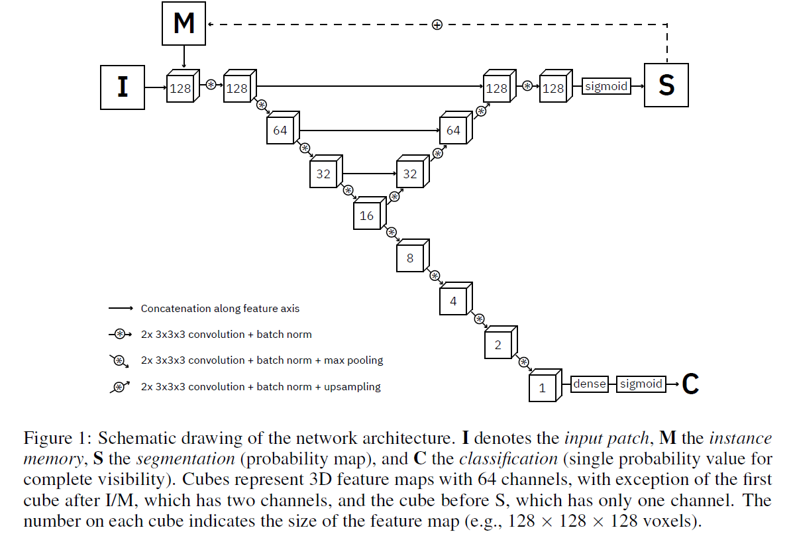
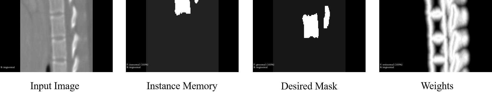
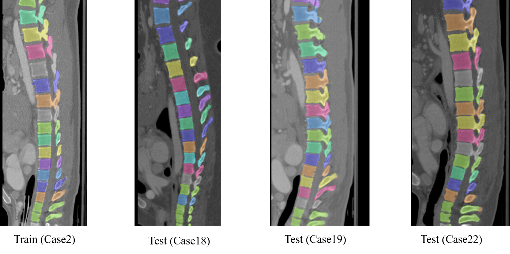

# Iterative FCN — Automatic Vertebra Segmentation (PyTorch)

PyTorch implementation of [Iterative fully convolutional neural networks for automatic vertebra segmentation](https://openreview.net/forum?id=S1NnlZnjG) (MIDL 2018). A later journal version with anatomical identification is [arXiv:1804.04383](https://arxiv.org/abs/1804.04383); **this repo follows the MIDL-style iterative segmentation + completeness head** (no anatomical label regression branch).

## Can you retrain / run inference?

**Yes.** Pipeline:

1. Install deps  
2. Preprocess CSI / SpineWeb Dataset 2 CT + labels → isotropic cropped volumes  
3. `python train.py ...` (or use `weights/IterativeFCN_pretrained.pth`)  
4. `python instance_segmentation.py ...` then optional `python eval.py ...`

You need a **GPU with ~12 GB** VRAM for 128³ patches (paper: Titan X, batch size 1).

---

## Quick start

```bash
git clone https://github.com/leohsuofnthu/Pytorch-IterativeFCN.git
cd Pytorch-IterativeFCN

python -m venv .venv
# Windows: .venv\Scripts\activate
# Linux/macOS: source .venv/bin/activate
pip install -r requirements.txt

# Optional sanity checks (loads pretrained weights if present)
python -m pytest test/test_e2e.py -v

# Preprocess CSI dataset (see Dataset below)
python -m data.preprocessing --dataset ./CSI_dataset

# Train
python train.py --dataset ./crop_isotropic_dataset --iterations 80000 --log_interval 1000

# Instance segmentation on test images
python instance_segmentation.py \
  --test_dir ./crop_isotropic_dataset/test/img \
  --weights ./weights/IterativeFCN_pretrained.pth \
  --output_dir ./pred

# Dice vs labels
python eval.py --label_dir ./crop_isotropic_dataset/test/seg --pred_dir ./pred
```

---

## Paper findings (audited against arXiv:1804.04383 PDF)

| Topic | Paper | This repo |
| --- | --- | --- |
| Input | Image patch + **instance memory** | Same (`torch.cat` of img + ins) |
| Patch size | **128³**, isotropic **1 mm³** | Same |
| Segmentation head | **Binary** current-instance mask + **sigmoid** (not softmax) | Same — intentional (GitHub issue #6) |
| Completeness | Sigmoid score + BCE | Same |
| Seg loss | `λ·FP_soft + FN_soft` with surface weights `ω=γ·exp(-d²/σ²)+1`, `γ=8`,`σ=6` | Same weights; **λ now anneals 0.1→1** per paper |
| Optimizer | Adam, lr **0.001**, momentum **0.99**, batch **1** | Adam `betas=(0.99,0.999)`, lr schedule 1e-3→1e-4→1e-5 (documented difference vs fixed 1e-3) |
| Inference | Sliding window, `vmin=1000`, CoM refinement until converge | Same + `max_steps` safety against endless loops |
| Anatomical ID loss | In journal version | **Not implemented** (MIDL / this repo) |

**Sigmoid vs softmax:** the network labels “current vertebra vs not” for one instance at a time; sigmoid is correct. Softmax multi-class would be a different design.

**Empty patches:** training samples an empty-mask example every `empty_interval=5` iterations (dataset) so the model can predict “nothing to segment”.

---

## Dataset

CSI 2014 spine segmentation challenge (SpineWeb **Dataset 2**):  
http://spineweb.digitalimaginggroup.ca/spineweb/index.php?n=Main.Datasets#Dataset_2.3A_Spine_and_Vertebrae_Segmentation  

> Some users report the download is flaky or offline (issues #3/#4). You need CT volumes + vertebra label masks in MetaImage (`.mhd`/`.raw`) form for preprocessing.

Place raw files under e.g. `./CSI_dataset/`, then:

```bash
python -m data.preprocessing \
  --dataset ./CSI_dataset \
  --output_isotropic ./isotropic_dataset \
  --output_crop ./crop_isotropic_dataset \
  --split_ratio 0.8
```

Preprocessing: resample to 1 mm³ → distance weight maps → crop unlabeled vertebrae → `crop_isotropic_dataset/{train,test}/{img,seg,weight}`.

---

## Training

```bash
python train.py \
  --dataset ./crop_isotropic_dataset \
  --weight ./weights \
  --checkpoints ./checkpoints \
  --iterations 80000 \
  --log_interval 1000 \
  --eval_iters 20 \
  --lr 1e-3 \
  --num_channels 64
```

| Flag | Notes |
| --- | --- |
| `--num_channels 64` | **Required** to match `IterativeFCN_pretrained.pth` (old bug used `4`) |
| `--resume` | Restore `checkpoints/latest_checkpoints.pth` |
| `--device cuda` / `cpu` | Auto-detected if omitted |

Outputs: `weights/IterativeFCN_best_train.pth`, `weights/IterativeFCN_best_valid.pth`, checkpoints under `./checkpoints/`.

---

## Inference & evaluation

```bash
python instance_segmentation.py \
  --test_dir ./crop_isotropic_dataset/test/img \
  --weights ./weights/IterativeFCN_pretrained.pth \
  --output_dir ./pred \
  --patch_size 128 --min_vol 1000 --max_alter 20
```

```bash
python eval.py --label_dir ./crop_isotropic_dataset/test/seg --pred_dir ./pred
```

---

## Model



Constant-width 3D U-Net-style FCN + completeness classifier. Released checkpoint shares encoder/decoder block weights (see `iterativeFCN.py`).

### Segmentation examples






| This repo (partial train) | Paper |
| --- | --- |
| ~0.918 Dice | ~0.958 Dice |

---

## Tests

```bash
python -m pytest test/test_e2e.py -v
```

Covers forward shapes, sigmoid binary head, pretrained weight load, FP/FN loss, patch clamping.

---

## Tips

| Issue | Fix |
| --- | --- |
| OOM | Keep `--batch-size 1`; reduce other GPU load |
| `Output size is too small` | Patches must be **128³** (divisible by 16); do not feed 64³ |
| Endless instance loop | Fixed with caudal `z` stop + `--max_steps`; update code |
| Pretrained load mismatch | Use `num_channels=64` |
| Dataset unavailable | See SpineWeb / issue tracker; preprocessing needs local CSI files |

---

## Authors

- **HSU, CHIH-CHAO** — ML Master’s student at [Mila](https://mila.quebec/)

## References

- MIDL 2018: https://openreview.net/forum?id=S1NnlZnjG  
- Journal / extended: https://arxiv.org/abs/1804.04383  
- 3D U-Net: https://arxiv.org/abs/1606.06650  
